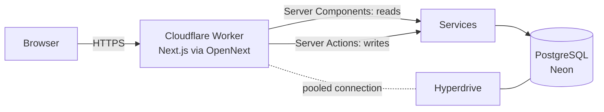
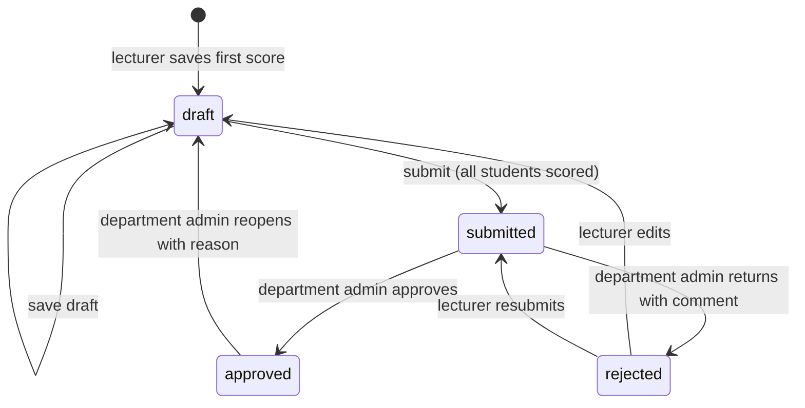

# Architecture

## Goals

The brief asks for a working MVP of a university portal whose core value is **trustworthy academic records**: the right person can do the right thing, nothing is lost or duplicated, and every important change can be traced. The design therefore puts correctness first (database constraints, transactions, an explicit workflow) and keeps the code small and layered so it is easy to review and extend.

## System overview



- **Cloudflare Workers** run the Next.js app at the edge (OpenNext adapter). There is no separate API server: pages render on the server, and every write is a Server Action.
- **Hyperdrive** keeps a warm pool of PostgreSQL connections close to the database. Workers start fresh for each request and cannot hold sockets open, so without Hyperdrive each request would pay for a new TLS + Postgres handshake and could exhaust the database's connection limit under load.
- **PostgreSQL (Neon)** is the single source of truth.

### Why PostgreSQL, not a serverless key-value or SQLite store

| Need from the brief | What PostgreSQL gives |
|---|---|
| "Prevent duplicate registration" | `UNIQUE (student_id, offering_id)`, which holds even under concurrent requests |
| "Database relationships between students, lecturers, courses…" | Foreign keys with `ON DELETE RESTRICT`: records still in use cannot be orphaned |
| "Submitted results cannot be edited", "traceable" | Row locks (`SELECT … FOR UPDATE`), multi-statement transactions, triggers |
| Reports | Aggregates, `FILTER`, window functions, JSON |
| Validation | `CHECK` constraints (score ranges, levels, units, one current semester) |

Cloudflare D1 (SQLite) was considered. It is simpler to provision, but it has no row-level locking, weaker concurrent-write behaviour and fewer integrity features, and those properties are the core of this domain.

## Layers (and how SOLID applies)

```
app/ (routes)          ──►  server/actions/   ──►  server/services/   ──►  server/db/
React Server Components     validate + authorize     use cases (+ audit)       schema + connection
                                                              │
                                                              ▼
                                                        domain/ (pure rules)
```

| Layer | Responsibility | Depends on |
|---|---|---|
| `domain/` | Grading scale, GPA, result-sheet state machine, unit limits. Pure functions, no I/O. | nothing |
| `server/db/` | Schema, constraints, connection factory | Drizzle |
| `server/auth/` | Password hashing, sessions, role/department policy functions | db |
| `server/services/` | One module per use-case area; every write is one transaction with its audit entry | domain, auth, db |
| `server/actions/` | Parse `FormData` with Zod, resolve the signed-in user, call one service, revalidate | services |
| `app/`, `components/` | Rendering only | actions, services (reads) |

- **Single responsibility:** each layer has one reason to change. A new grading rule touches `domain/grading.ts` only; a new screen touches `app/` only.
- **Open/closed:** the result workflow is a transition table (`domain/result-sheet.ts`). Adding a state (e.g. "Senate approved") means adding one entry, not editing every `if`.
- **Liskov / interface segregation:** services accept a small `ServiceContext { db, actor, ipAddress }`, and `Executor = Database | Transaction`, so any function can run standalone or inside a caller's transaction.
- **Dependency inversion:** services never import Next.js, cookies or headers. The context is passed in, so the integration tests call services directly with an in-memory database.

## Request lifecycle (a write)

1. The browser posts a form to a **Server Action**. Next.js rejects cross-origin action requests (Origin/Host check), which protects against CSRF.
2. The action parses input with a **Zod** schema. Invalid input returns field errors and never reaches a service.
3. `serviceContext(role)` resolves the session cookie to an active user and checks the role.
4. The **service** opens a transaction:
   1. it locks the rows it will change;
   2. it applies **policy checks against the stored record** (e.g. "this course belongs to your department");
   3. it validates business rules and writes;
   4. it records the audit entry, then commits.
5. Expected failures (`AppError`) become friendly messages. Unique and foreign-key violations map to clear messages. Anything else is logged and shown as a generic error.

## ACID in practice

| Operation | How it stays correct |
|---|---|
| Course registration | One transaction. `SELECT … FOR UPDATE` on the student row serialises that student's concurrent submissions, so a double click or two tabs cannot exceed the unit limit. Availability and unit totals are re-checked inside the lock. The unique index is the final guard. |
| Saving / submitting scores | All scores in the grid are written in one transaction, or none are. Submission additionally requires every registered student to have a score. |
| Approve / reject / reopen | Sheet row locked. Version compared with the version the reviewer saw (optimistic concurrency). Transition validated by the state machine. Audit entry committed with the change. |
| Setting the current semester | Clearing the old one and setting the new one happen atomically. A partial unique index guarantees at most one current semester. |
| Suspending a user | Status change and session revocation in one transaction, so the user is signed out at once. |

## Result workflow



- Lecturers can edit only in `draft` or `rejected`.
- Students only ever see results whose sheet is `approved`. This is enforced in the query, not just hidden in the UI.
- A reviewer can never approve or reject a sheet they submitted themselves (relevant when a department admin also teaches).

## GPA

- **Grading scale:** stored in the `grade_scale` table and seeded with the standard Nigerian 5-point scale:

  | Score | Grade | Points |
  |---|---|---|
  | 70–100 | A | 5 |
  | 60–69 | B | 4 |
  | 50–59 | C | 3 |
  | 45–49 | D | 2 |
  | 40–44 | E | 1 |
  | 0–39 | F | 0 |

- **Grades are fixed when scores are saved:** the grade and points are stored with each result, so later changes to the scale never rewrite historical results.
- **Calculation:** GPA = Σ(units × grade points) ÷ Σ(units), rounded to 2 decimal places. The calculation lives in `domain/gpa.ts` and is unit tested.
- **CGPA:** the same calculation across all approved results to date. Failed courses (F) count their units, as is standard.
- **Degree class:** First Class ≥ 4.50, Second Class Upper ≥ 3.50, Second Class Lower ≥ 2.40, Third Class ≥ 1.50, Pass ≥ 1.00.

## Edge cases handled

| Area | Case | Handling |
|---|---|---|
| Registration | Double click / two tabs | Row lock + unique index; the second request sees the first |
| | Course from another department, level or semester | Not listed; refused server-side if posted anyway |
| | Over 24 units | Live counter in the UI; refused in the transaction |
| | Registration closed | Read-only page; server refuses |
| | Failed course from a lower level | Offered again as a carry-over |
| | Dropping a course after scores exist | Refused |
| Results | Out-of-range, half-filled or non-numeric scores | Per-cell errors; nothing saved (all-or-nothing) |
| | Submitting with missing scores | Refused with a count of missing students |
| | Editing after submission / approval | Refused; approved results need an audited reopen with a reason |
| | Two admins reviewing at once / stale tab | Version check refuses the second action |
| | Reviewer is the submitter | Refused |
| | Grading scale changes later | Stored grade snapshot keeps history intact |
| Access | Changing an ID in the URL or form to reach another department | Policies check the stored record's department; pages answer 404 |
| | Suspended or deactivated user with an open session | Sessions revoked; every request re-checks status |
| | Role changed | Sessions revoked; next sign-in gets the new role |
| Data | Deleting a department or course still in use | Foreign keys `RESTRICT`; courses are deactivated instead |
| | Duplicate emails / matric numbers in different case | Case-insensitive unique indexes |
| | Two "current" semesters | Partial unique index |
| Platform | Worker CPU limits | Password hashing uses native Web Crypto (PBKDF2), not a JS bcrypt |
| | Time zones | Stored in UTC (`timestamptz`), shown in Africa/Lagos |
| | Unexpected errors | Generic message with a reference digest; details only in server logs |

## Scaling

- **Stateless workers:** they scale horizontally on Cloudflare's network, and Hyperdrive pools and caches database connections.
- **Indexes:** they cover every lookup path: registrations by offering, results by sheet, audit by entity and time, users by department.
- **Reports:** they are single aggregate queries. At larger scale they can move to materialised views refreshed after approvals.
- **Background work:** emails and bulk imports would go to Cloudflare Queues, so requests stay fast (out of scope for the MVP).
