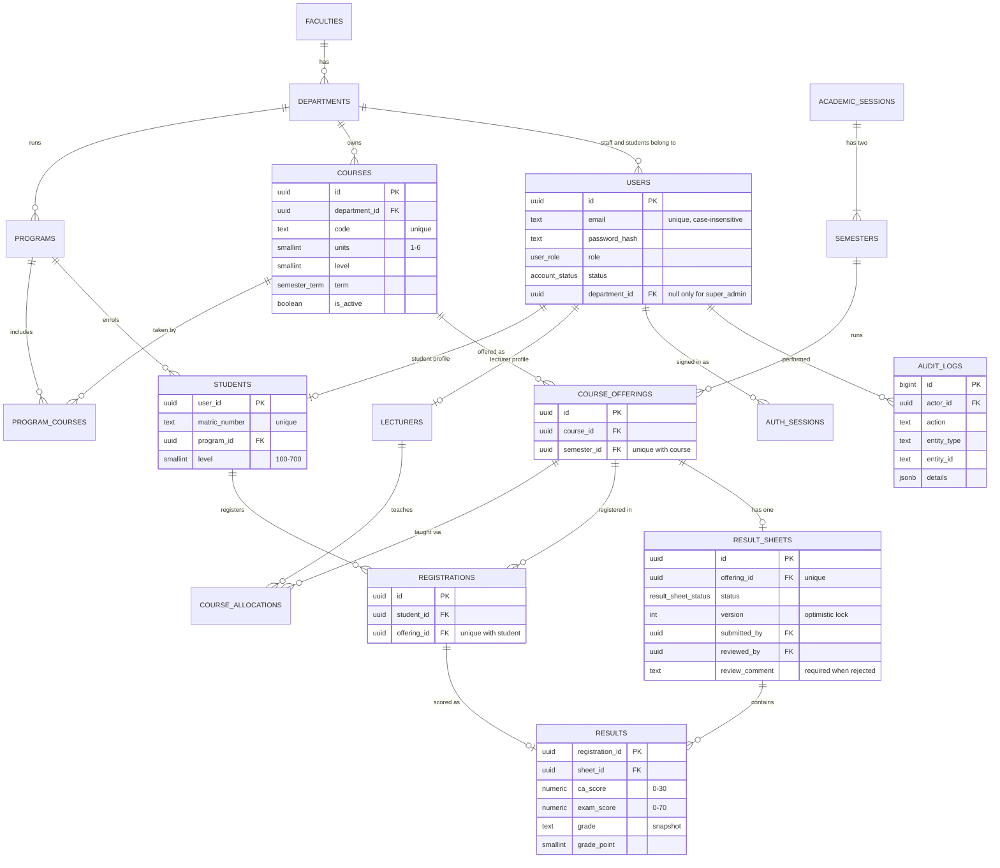

# Database design

PostgreSQL. The schema is defined in [`src/server/db/schema.ts`](../src/server/db/schema.ts) and applied by the SQL migrations in [`drizzle/`](../drizzle).

## Entity-relationship diagram

## Key modelling decisions

- **Course vs offering.** A *course* (CSC 201, 3 units) is catalogue data. An *offering* is that course running in a specific semester. Registrations, lecturer allocations and result sheets hang off the offering, so history is preserved across sessions and "the same course twice in one semester" is a single unique index.
- **Programs ↔ courses is many-to-many** (`program_courses`). It decides which students can register a course, and whether the course is core or elective for them.
- **One user table, role profiles alongside.** `users` holds identity and role. `students` and `lecturers` hold role-specific data, keyed by the same id. A department admin who also teaches has both an admin role and a lecturer profile.
- **One result sheet per offering** carries the workflow state, a version for concurrency control, and who submitted and reviewed it. Individual `results` rows carry the scores.
- **Grades are stored, not recomputed.** Changing the grading scale never alters an approved result.
- **The audit log is append-only.** Rows can be inserted but never updated or deleted, enforced by a database trigger.

## Integrity constraints

| Rule | Enforced by |
|---|---|
| No duplicate course registration in a semester | `UNIQUE (student_id, offering_id)` |
| One result per registration | `results.registration_id` primary key |
| One sheet per course offering | `UNIQUE (offering_id)` on `result_sheets` |
| CA 0–30, exam 0–70 | `CHECK` constraints |
| Units 1–6, levels 100–700, program duration 1–7 years | `CHECK` constraints |
| Only one current semester | Partial unique index `WHERE is_current` |
| Each session has one first and one second semester | `UNIQUE (session_id, term)` |
| Session ends after it starts | `CHECK (ends_on > starts_on)` |
| Non-super-admins belong to a department | `CHECK (role = 'super_admin' OR department_id IS NOT NULL)` |
| A returned sheet has feedback | `CHECK (status <> 'rejected' OR review_comment IS NOT NULL)` |
| Unique emails, matric and staff numbers regardless of case | Unique indexes on `lower(email)`, `upper(matric_number)`, `upper(staff_number)` |
| Records in use cannot be deleted | Foreign keys with `ON DELETE RESTRICT` |
| Audit entries are permanent | `BEFORE UPDATE/DELETE` trigger raises an error |
| Every score change is traceable | `AFTER INSERT/UPDATE` trigger on `results` logs old and new scores |

## Indexes

Beyond primary keys and the unique constraints above:
- `registrations(offering_id)`: class lists;
- `results(sheet_id)`: score sheets;
- `result_sheets(status)`: approval queues;
- `course_allocations(lecturer_id)`: "my courses";
- `users(department_id)`, `students(program_id)`, `courses(department_id)`: department scoping;
- `audit_logs(entity_type, entity_id)`, `(actor_id)`, `(created_at)`: tracing and the activity log;
- `login_attempts(lower(email), created_at)`: brute-force lockout.
